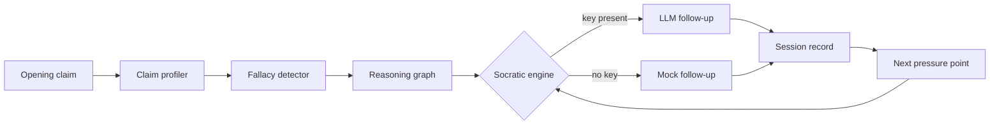

<div align="center">

# Socratic Debate Partner

**An AI debate partner that argues the other side — and shows you where your reasoning breaks.**

[](https://adineo-cmd2.github.io/socratic-debate-partner/)
     

[](https://github.com/adineo-cmd2/socratic-debate-partner/stargazers) [](https://github.com/adineo-cmd2/socratic-debate-partner/commits)

[Live site](https://adineo-cmd2.github.io/socratic-debate-partner/) · [Quick start](#quick-start) · [How it works](#how-it-works) · [Features](#features)

</div>

---

State a belief and the engine takes the opposing position. It profiles the
claim, maps the argument as a reasoning graph, and aims each follow-up at the
weakest link in the chain rather than the easiest one.

It runs in a mock Socratic mode with **no API keys at all**. Add an Anthropic or
OpenAI key and the same loop uses a live model.

## Features

| | Feature | What it does |
| --- | --- | --- |
| 🎯 | **Claim profiling** | Extracts stance, assumptions and confidence from the opening statement. |
| 🕸️ | **Reasoning graph** | Renders every argument chain as a navigable force-directed graph. |
| 🔁 | **Follow-up pressure** | Each session step returns the next question at the weakest node. |
| 📉 | **Fallacy profile** | Tracks reasoning patterns across sessions instead of scoring one reply. |

## How it works

A session is a loop over one model of your argument:

1. `POST /api/session/start` profiles the opening claim.
2. The fallacy detector and graph builder turn the claim into typed nodes.
3. The Socratic engine produces the next question — live model when a key is
   present, deterministic templates otherwise.
4. `POST /api/session/respond` appends your reply, rebuilds the graph and picks
   the next pressure point.

Nothing is hard-coded into the UI: the profile, graph and progress views all read
the same session record.



## Quick start

Backend needs Python 3.11+ and a virtualenv. Frontend needs Node 18+.

**Backend**

```bash
cd backend
python3 -m venv .venv && source .venv/bin/activate
pip install -r requirements.txt
cp .env.example .env          # add a provider key for live model calls
python3 -m uvicorn app.main:app --reload --port 8001
```

**Frontend**

```bash
cd frontend
npm install
npm run dev                   # http://localhost:4321
```

**Tests**

```bash
python3 -m pytest backend/tests/ -v
```

## Project structure

```text
backend/
  app/
    main.py        FastAPI app and router mounting
    api/           request dependencies
    models/        SQLAlchemy tables
    schemas/       Pydantic request/response models
    services/      the analysis pipeline
  tests/           pytest suite
frontend/
  src/pages/       Astro routes
  src/lib/         API client and shared helpers
```

## Configuration

| Variable | Default | Purpose |
| --- | --- | --- |
| `DATABASE_URL` | `sqlite:///./socratic.db` | Per-app SQLite database |
| `JWT_SECRET` | `dev-only-change-me` | Session token signing |
| `ANTHROPIC_API_KEY` | (empty) | Anthropic provider for live analysis |
| `OPENAI_API_KEY` | (empty) | OpenAI provider for live analysis |
| `FRONTEND_ORIGIN` | `http://localhost:4321` | Allowed CORS origin |

## Deployment

The frontend is a static build and deploys to GitHub Pages on every push
to `main` through `.github/workflows/deploy.yml`:

**https://adineo-cmd2.github.io/socratic-debate-partner/**

The backend is not part of that deployment. Run it yourself, then point the
frontend's API base at it.

## Part of the suite

This app is one of ten independent rooms in
**[Atrium](https://github.com/adineo-cmd2/atrium)**. Each room has its own
backend, SQLite database, search index and frontend; the portal only links them.

- [Cognitive Bias Detector](https://github.com/adineo-cmd2/cognitive-bias-detector) — names the biases behind a claim.
- [Contradiction Finder](https://github.com/adineo-cmd2/contradiction-finder) — finds claims that cannot both be true.
- [Premortem Engine](https://github.com/adineo-cmd2/premortem-engine) — pressure-tests a plan before it ships.

## Contributing

Issues and pull requests are welcome. For anything larger than a typo or a
small fix, open an issue first so the approach can be agreed before the work.

- Bugs and ideas: [issues](https://github.com/adineo-cmd2/socratic-debate-partner/issues)
